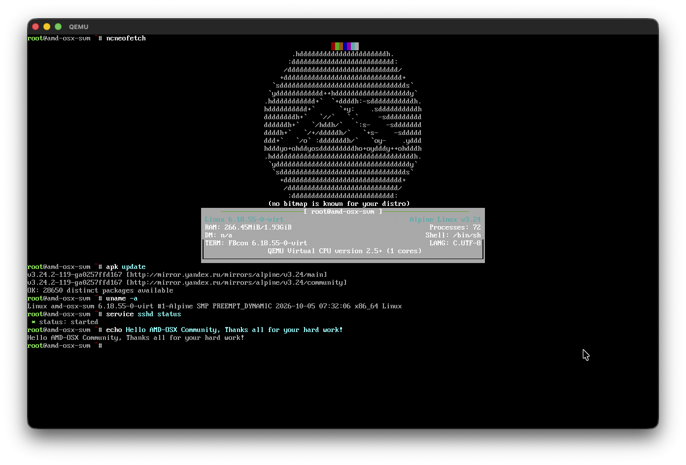

# osx-svm-accel — AMD SVM acceleration for QEMU on macOS

[Русский](docs/ru/README.md)

AMDVM is an experimental AMD SVM provider for x86_64 macOS and a native QEMU accelerator named `amdsvm`. The kernel extension executes guest CPU instructions through SVM; QEMU supplies the virtual machine and device model. Users choose their own disks, installation media, memory and CPU topology through ordinary QEMU options. There is no guest-OS detector or bundled image.

On the reference Ryzen 7 5700X Hackintosh running macOS Tahoe 26.0.1, Alpine Linux 3.24 boots from ISO and an installed disk to an interactive console without additional guest kernel arguments. Two guest cores are online and have passed a short pinned workload at 256 MiB RAM. Alpine also booted with 4 GiB RAM; that earlier run had only CPU0 online. A separate finite ROM passed with two executing vCPUs and 4 GiB. These are distinct results.

AMDVM requires no additional XNU patches or custom XNU build beyond the existing Hackintosh configuration. It does not use Hypervisor.framework or TCG for guest CPU execution; intercepted operations are emulated in QEMU.

**Research prototype, tested on one host.** Read [risks](docs/en/risks.md). Support for one tested guest does not establish compatibility with other OSes.



The screenshot records the earlier single-vCPU / 2-GiB session. See the [reference evidence](evidence/reference-2026-10-14/README.md) for SMP results.

## Build and use

```sh
make provider-experimental  # build only; no installation or hardware entry
make checks                # offline provider checks
make qemu                  # pinned upstream checkout + source overlay + build
make qemu-checks            # offline QEMU unit tests
```

Requires an Intel/AMD x86_64 macOS build host, Xcode Command Line Tools, Python 3, Git, Ninja, pkg-config, GLib and Pixman. SLIRP is resolved from the system or QEMU's pinned subproject. See [build and run](docs/en/build-and-run.md) for signing, manual installation, verification, rollback and guest commands.

After the matching provider is loaded, select:

```text
-accel amdsvm,confirm-experimental-run=on,confirm-no-kdp-watchpoints=on
```

Then use `-m`, `-smp`, `-drive` and `-cdrom` normally. The publication frontend accepts **1–2 vCPUs and 256 MiB–4 GiB RAM**, subject to provider capabilities and successful memory preparation. CPU hotplug is rejected. Those accepted limits are not a claim that every combination or guest has been tested. The generic frontend has build, offline and live prelaunch ABI checks; hardware runs used the preceding QEMU frontend. [Manifest](MANIFEST.json) distinguishes them.

Verify the extracted source package with `shasum -a 256 -c SHA256SUMS`.

## Contents

| Path | Contents |
| --- | --- |
| `svm-kext/` | provider, versioned ABI, diagnostic client, mock headers |
| `tools/` | offline tests and QEMU preparation/build scripts |
| `qemu/` | 40 added/modified upstream files and checksum manifest; no full QEMU tree |
| `evidence/` | selected reference results, identities and validation limits |
| `docs/en/`, `docs/ru/` | English and Russian documentation |

## Documentation

- [Architecture](docs/en/architecture.md)
- [QEMU changes](docs/en/qemu-integration.md)
- [Hardware and test matrix](docs/en/hardware.md)
- [Build, run and rollback](docs/en/build-and-run.md)
- [Risks and limitations](docs/en/risks.md)
- [Development method](docs/en/development.md)
- [Project story](docs/en/story.md)
- [AMD-HVF research proposal](docs/en/amd-hvf-proposal.md)

[osx-svm-poc](https://github.com/nekkitl/osx-svm-poc) remains the separate minimal HLT-transition PoC. This repository contains the QEMU integration and current provider source. Next work: repeated SMP lifecycle tests, additional resource sizes, guest compatibility and performance measurements. AMD-HVF is a separate future compatibility study.

## Contributing

See [CONTRIBUTING.md](CONTRIBUTING.md) for changes, checks and hardware reports. Issue templates cover runtime results, build/loading problems and feature requests.

## License

Original project code: GPL-2.0-or-later. Upstream-derived QEMU files retain their notices and applicable licenses. See [LICENSE](LICENSE), [qemu/COPYING](qemu/COPYING) and [THIRD_PARTY.md](THIRD_PARTY.md).

© 2026 Nick Ognev.
