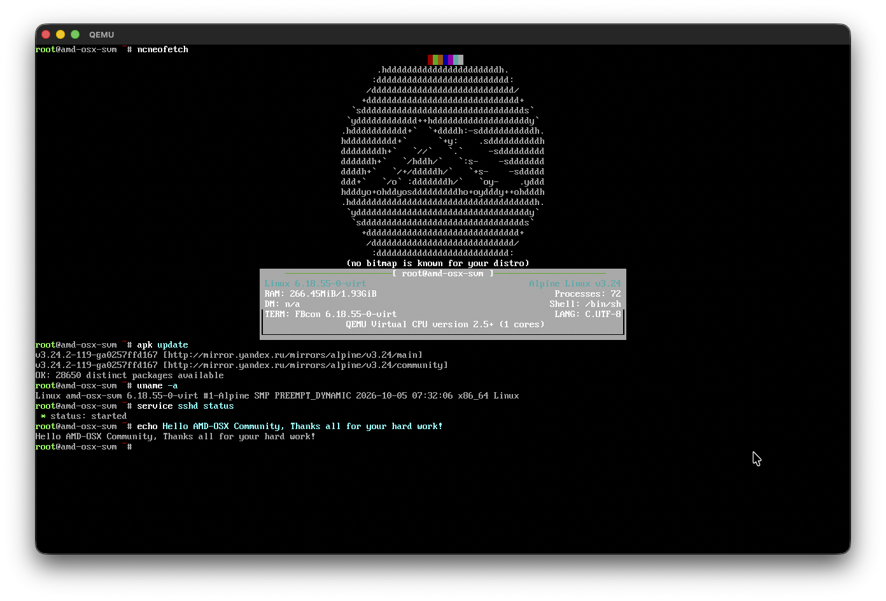

# From a single instruction to a working Linux: how I wrote my own VMM for AMD Hackintosh with the help of AI agents

*A story about a long-standing AMD-OSX problem, hardware virtualization under XNU, one kernel panic, the work of autonomous AI agents — and the next goal: an AMD-HVF Compatibility Layer.*

Recently I got a screenshot that at first glance looks completely unremarkable. An ordinary QEMU window on macOS with Alpine Linux 3.24 running inside. A console is open, a few commands have been executed, and information about the CPU and the system kernel is on screen. Nothing unusual — unless you know one detail: the Linux is running with AMD SVM hardware acceleration on a Ryzen Hackintosh, and the virtualization is provided by my own kernel extension for XNU and a QEMU accelerator written for it.

There is no Linux KVM here, because the host system is macOS. There is no Apple Hypervisor.framework, because its x86 implementation targets Intel VMX. There is no software CPU emulation through QEMU TCG either. Instead, guest code actually executes in hardware via AMD SVM, and a custom VMM manages the virtual CPU state, memory, intercepts and the switching between guest and host.

The funny part is that initially I had no plans to write a full-blown hypervisor at all. I simply wanted to deal with one of the oldest limitations of AMD Hackintosh. And then it gradually turned into a full-scale study of CPU architecture, XNU, multiprocessor synchronization, and the capabilities of modern development with autonomous AI agents.

Behind this result there are not only successful builds and pretty screenshots, but also misconfigured VMCB bits, physical memory mapping errors, countless VMEXITs, XSAVE problems, broken regression tests and one real kernel panic. A significant part of the research and implementation was done by AI agents, while I had to manage their work, make architectural decisions and constantly verify that the next claim of success was actually backed by technical facts.

But let's take it from the beginning.

## AMD-OSX: when the system works, but not quite

As many know, I love Hackintosh. And Hackintosh has never been an occupation for the faint of heart, while running macOS on AMD is an engineering challenge of its own. The AMD-OSX community has spent years making Apple's operating system work on processors it was never officially released for. Kernel patches, OpenCore, the specifics of AMD microarchitectures, component compatibility and the constant changes of new macOS versions — all of this is well known to anyone who has ever tried to achieve truly stable operation of such a system.

In the end you can get a fully functional working environment. In my case, for example, macOS Tahoe runs on Ryzen with hardware graphics acceleration, the usual set of applications and all the necessary infrastructure. The system is used not only for experiments, but also for everyday tasks. However, even if you achieve near-perfect Hackintosh operation, there remain limitations that cannot be removed by yet another CPU compatibility patch.

One of the most unpleasant — hardware virtualization.

On Intel Macs, the built-in Hypervisor.framework uses Intel VMX capabilities. AMD processors offer their own hardware virtualization technology — Secure Virtual Machine, or SVM. These are not two names for one mechanism, but different architectural interfaces with their own instructions, control structures, exception handling rules and ways of managing guest code.

Intel VMX uses VMCS and the VMX family of instructions. In AMD SVM the foundation is the VMCB, and entry into guest mode is performed by the `VMRUN` instruction. The mechanisms for managing interrupts, intercepts, virtual memory and processor state also differ. Therefore, patches that let XNU run on Ryzen do not automatically make Hypervisor.framework an AMD-compatible hypervisor.

Hence the long-standing AMD-OSX problem: you can make macOS run on an AMD processor, but you cannot automatically get the full functionality available on an officially supported platform.

VirtualBox 6.1.50 executed AMD SVM on this Tahoe host without an additional AMDVM-specific XNU patch. That was a practical precedent; it did not prove AMDVM safety. Our critical world-switch properties still needed independent checks.

If you need virtual machines for labs, OS research, infrastructure testing or information security tasks, the lack of proper hardware acceleration becomes quite a tangible limitation. Especially when you have a modern Ryzen under the hood that supports virtualization in hardware, but the operating system provides no suitable interface.

At some point I wondered: how hard would it be to implement my own AMD SVM backend for macOS? Not to rework Hypervisor.framework and not to port KVM wholesale, but to create an independent mechanism that can use the processor's hardware capabilities directly from XNU.

The answer turned out to be fairly simple: hard. Very hard. But possible.

## The first experiment: VMRUN from XNU

The initial concept was fairly compact. Create a custom kernel extension, prepare the AMD SVM structures and execute a minimal guest program. Without a real virtual machine, BIOS, operating system or device emulation. The main goal was to check whether a running macOS allows the hardware transition into guest mode — and a correct return back.

AMD SVM uses the Virtual Machine Control Block, or VMCB — a structure that contains control parameters and part of the guest's architectural state. To enter virtualization you need to configure the relevant processor registers, prepare a host save area, enable `EFER.SVME` and execute the `VMRUN` instruction. When an intercepted event occurs, the processor returns control to the hypervisor and the exit reason is recorded in the control structure.

The first guest program was a single instruction — `HLT`. If everything is configured correctly, the processor should enter guest mode, encounter HLT, produce `VMEXIT_HLT = 0x78` and return control to the kernel extension. After that, you need to restore the original processor state and verify that the experiment left no changes capable of affecting the host.

Sounds relatively simple, but even at this stage I had to deal with the specifics of the XNU ABI, IOKit, structure sizes, register preservation and processor state. Kernel-userspace interaction demands care: a type or size mismatch can turn a completely harmless call into kernel memory corruption.

In the end, the first hardware transition worked. The processor really did execute the guest HLT, returned the expected VMEXIT, and the extension was able to complete the experiment correctly and restore the verifiable SVM state.

Based on this work I prepared a separate open project — [osx-svm-poc](https://github.com/nekkitl/osx-svm-poc). It is a small research Proof of Concept containing an XNU kernel extension, an IOKit provider and a userspace client. It demonstrates the fundamental possibility of using AMD SVM under macOS, but it is not a full hypervisor and is not intended to run arbitrary operating systems.

The project documentation is available [in English](https://github.com/nekkitl/osx-svm-poc/tree/main/docs/en).

And here it is necessary to separate two results. The public osx-svm-poc confirms the very possibility of a hardware SVM transition. The further development, which I conventionally call AMDVM, went much further and gradually turned into a full-fledged Virtual Machine Monitor prototype.

## Why I decided to use AI agents

Around that stage I became interested in testing another hypothesis. Can development of software as complex and low-level as this be organized with autonomous AI agents — if you do not treat them as ordinary editor autocompletion or a code generator driven by a text prompt?

Today there is a rather strange polarization around AI development. Some are convinced that all you need is to formulate the task properly — and the neural network will write any system by itself. Others consider the approach useless because generated code often contains errors, unnecessary dependencies, or solutions that cannot be maintained. In my opinion, both positions miss an important part of what is happening.

AI agents are indeed capable of performing a significant amount of engineering work. They can study large codebases, analyze architectural documentation, research other implementations, write individual components, do reviews, run tests and fix bugs. But none of this means that agents automatically understand the project's goals, its security model, or the consequences of the decisions being made.

So I did not give them the abstract task "write a hypervisor". The work was organized around individual subsystems, technical constraints and verifiable results. The agents studied XNU sources, researched the AMD SVM architecture, worked through VirtualBox and QEMU mechanisms, prepared code changes, wrote tests and analyzed the results of hardware runs. The architectural direction, security requirements and completion criteria for experiments remained under my control.

And here there is a fundamentally important point. To manage development like this, a person needs serious technical knowledge. It is not enough to be able to formulate a prompt and judge how convincing the model's answer looks. You need to understand x86 architecture, the specifics of hypervisors, operating system internals, physical memory management, processor synchronization, interrupt handling and the consequences of errors at the kernel level.

For example, an agent can successfully build a kernel extension, run several hardware tests and report that the mechanism is safe. But a successful compilation does not confirm the correctness of the world-switch. A few successful VMRUNs do not guarantee that all host registers are preserved. And correct restoration of `EFER.SVME` does not yet mean that during guest execution XNU will be able to service inter-processor interrupts in time.

The most important part of the work became precisely the definition of the boundaries of proof. What does a particular test confirm? Which properties does it not check? Which invariants can be violated? What additional measurements are needed before moving to the next stage?

In practice, the agents were far from always acting perfectly. Sometimes they got stuck in repeated audits, added unnecessary complexity, broke previously working smoke tests, or interpreted results too optimistically. I had to stop experiments, return to the original requirements and force the system to investigate the specific cause of a failure instead of adding yet another workaround.

But it was precisely with this approach that agent-driven development began to demonstrate its real capabilities. Instead of sequentially studying each individual subsystem by hand, it became possible to organize parallel work on code, documentation, tests and architectural hypotheses.

**AI agents can scale engineering competence, but they do not create it out of nothing. The higher the autonomy of the agents, the more important the knowledge and responsibility of the person managing them.**

AMDVM became a very illustrative test of this statement.

## From a hardware primitive to a custom QEMU accelerator

After the first successful VMRUN, the next goal was QEMU integration. I did not want to implement the entire PC model myself, including drives, PCI, video cards, BIOS and the rest of the devices. It is far more logical to use the existing QEMU, which already knows how to provide a full virtual platform to the guest, and add my own hardware CPU execution mechanism to it.

That is how the architecture with a separate `amdsvm` accelerator came to be.

QEMU manages the virtual machine, models devices and handles the necessary architectural events. AMDVM, for its part, is responsible for hardware execution of the guest CPU, memory mapping and the safe transition between the user process, the kernel provider and AMD SVM.

Schematically it looks like this:

```text
macOS Tahoe / XNU
        |
        v
QEMU -accel amdsvm
        |
        v
IOUserClient
        |
        v
AMDVMProbe.kext
        |
        v
AMD SVM / VMRUN
        |
        v
Guest x86-64
```

To make such a system work, a VMRUN handler alone is no longer enough. It required transferring x86 architectural state, working with general-purpose registers, segments, CR, DR and MSR, supporting XSAVE/XRSTOR, managing vCPUs, handling exceptions and various classes of VMEXIT.

Virtual memory became a separate direction. QEMU creates the guest RAM inside its userspace process, but hardware SVM needs the corresponding physical pages for Nested Page Tables. I had to implement pinning of userspace memory via IOMemoryDescriptor, obtaining physical addresses, building the NPT, and correctly synchronizing the mappings with QEMU's memory model.

And it very quickly turned out that simply correlating guest addresses with physical memory is not enough. You must account for PAT and MTRR, different memory types, access permissions, mapping changes and the need for correct TLB flushes. If you make a mistake, the guest can get incorrect data, access forbidden memory, or end up in a situation where the hardware translation no longer matches the virtual machine model.

Resource management turned out to be no less interesting. What happens if an operation releasing pinned memory fails? How do you prevent releasing an object that already belongs to another context? How do you guarantee that a failed VM destruction does not leave dangerous references to physical pages in the kernel?

As a result, custom quarantine, ownership checks, generation counters, rollback and fault injection appeared. Against the backdrop of booting a real Linux this looks rather boring, but it is precisely such details that distinguish a demonstration of a processor instruction from a system one can even attempt to use for executing arbitrary guest code.

Gradually AMDVM began to acquire the traits of a real hypervisor.

## One character the entire architecture hinged on

The first goal after QEMU integration was a small microguest. A ROM program was supposed to execute CPUID, send a character to the debug port and halt via HLT. The expected sequence of hardware exits was: CPUID, I/O and HLT.

Instead, the processor was returning `VMEXIT_EXCP_UD = 0x46`, the invalid-opcode exception.

The investigation began. The agents checked the reset vector, the ROM placement, segment register state, CR0, EFER, NPT and the actual bytes of the guest code. At first glance everything looked correct. But in the end a rather unpleasant bug was found: the RUN handler was clearing the wrong VMCB field and, immediately before hardware entry, was in effect disabling `NP_ENABLE`.

After the fix, the processor finally performed the expected sequence, and QEMU handled all three exits.

Then the experiment was made more complex. A real QEMU q35 machine with 512 MiB of RAM was prepared. The guest program read a byte from RAM at address `0x1000` and then sent it through the emulated debug port. The memory contained the value `0x41`, the character `A`.

And QEMU really printed `A`.

Seemingly nothing special. One letter in the terminal. But behind it stood an entirely different amount of working infrastructure: QEMU memory, pinned physical pages, NPT, hardware VMRUN, the guest processor accessing memory, a VMEXIT on I/O, device handling and the return of control to XNU.

At that moment it became obvious that AMDVM had stopped being just an experiment with individual instructions. We now had a working foundation for hardware acceleration of a virtual machine.

But the next problem turned out to be far more serious.

## The first kernel panic

One of the most important capabilities of a full hypervisor is forcibly stopping a virtual processor. A guest system is under no obligation to voluntarily execute HLT or another interceptable instruction at a moment convenient for the host. Therefore the hypervisor must be able to return control to the operating system regardless of the guest's behavior.

It was precisely while researching this mechanism that macOS went into a real kernel panic for the first time.

The XNU diagnostics showed:

```text
NMIPI for unresponsive processor
TLB flush timeout
IPI timeout
unresponsive CPU bitmap: 0x1
```

One logical processor was waiting for another to acknowledge a TLB flush operation, but did not receive it in time. The CPU whose response was expected was at that moment occupied with executing AMDVM. As a result, XNU declared the processor unresponsive and initiated a panic.

This is no longer a virtual machine error, a guest exception or a QEMU crash. This is a violation of how the experimental VMM interacts with macOS's own multiprocessor model.

After the reboot I had to parse the panic log, symbolicate addresses inside the assembly wrapper and study the hardware world-switch sequence almost instruction by instruction. Special attention went to `CLGI`, `STI`, `VMRUN`, `CLI`, `STGI`, host IF/GIF and the physical interrupt interception mechanism.

One of the most interesting symbolication results showed the diagnostic RIP was located immediately after `STGI`, while the ordinary IF flag was still clear. But concluding that the processor had hung on that very instruction would be wrong: the diagnostic NMI could have been waiting for GIF to be restored and only reached the handler after the corresponding critical section completed.

In parallel we started studying existing AMD SVM implementations, including the sources of old VirtualBox 6.1.50. Its world-switch used a similar scheme for entering guest mode and restoring host state. It was a useful architectural reference, especially given that VirtualBox historically had its own AMD SVM implementation.

VirtualBox 6.1.50 executed AMD SVM on this Tahoe host without an additional AMDVM-specific XNU patch. That was a practical precedent; it did not prove AMDVM safety. Our critical world-switch properties still needed independent checks.

After the first kernel panic, the approach to experiments changed noticeably. Now it was not enough to show that the processor can execute guest code and return correctly on an ordinary VMEXIT. It was necessary to make sure that during hardware guest execution XNU retains the ability to service critical inter-processor operations.

This turned out to be one of the most difficult and interesting parts of the project.

## When the hypervisor starts getting in the operating system's way

To study how AMDVM interacts with XNU, separate diagnostic tools, DTrace probes and controlled hardware-execution scenarios appeared. We began measuring TLB shootdown latencies, recording physical VMEXITs and checking CPU participation in inter-processor operations.

In one of the hardware runs, 270 VMRUN entries and 1,078 remote TLB flush requests directed at the guest CPU were recorded. All observed requests completed, and the maximum measured latency was 166 microseconds. After the test, the verifiable SVM state of all 16 logical processors matched the initial one.

That was a very good result, especially after the earlier timeout. But it still did not prove that arbitrary guest code could not disrupt the host. We needed to separately verify whether XNU can initiate an `mp_rendezvous()` operation directly during an active VMRUN.

At first, that experiment stubbornly refused to work. The diagnostic query ran after SeaBIOS had already finished, so the `mp_rendezvous()` call never landed inside the hardware window of guest execution. Suspicions appeared about IOKit serialization, provider locks and a misorganized control plane.

Later the real reason turned out to be much simpler: SeaBIOS finished in about 8 milliseconds, while the separate diagnostic process took about 24 milliseconds to reach the kernel provider. The request simply did not make it into the right time window.

That was a good lesson in technical diagnostics. The absence of an observed event does not prove the absence of a mechanism, and a badly designed experiment is fully capable of leading research in a completely unnecessary direction.

For the next check we used a finite ROM program with a controlled loop and HLT at the end. It let us keep the guest executing long enough for another process to initiate a rendezvous, without requiring a real operating system.

And this time the experiment passed.

The rendezvous request really did land during hardware guest execution, the processor returned through `VMEXIT_INTR`, consistent results were obtained across all 16 CPUs, and the other 15 logical processors kept being scheduled. Additionally, QMP was able to stop the guest in a measured 0.865 milliseconds.

It is important to interpret such results correctly. We did not obtain a mathematical proof that AMDVM can stop any guest workload within 0.865 ms. Nor did we prove the complete safety of all possible combinations of hardware events. But we obtained direct confirmation that a critical mechanism works: XNU really can initiate an inter-processor operation during guest execution, and AMDVM can return control through a physical VMEXIT in the tested scenario.

It was here that the development finally stopped being a question of "how to invoke VMRUN". We had to study how a hypervisor should coexist with a full multiprocessor operating system without depriving it of control over its own processors.

In my opinion, this was one of the most important stages of the whole effort.

## SeaBIOS: moving from synthetic tests to a real virtual machine

When the basic mechanisms became mature enough, we decided to move to running a real SeaBIOS. And here it turned out that there is a huge difference between a microguest of a few instructions and real firmware.

SeaBIOS works with a full PC model. It needs ROM, RAM, PCI, interrupt controllers, devices, MMIO regions, legacy I/O ports and a correct memory map. QEMU already knows how to model many of these components, but AMDVM must correctly forward the corresponding accesses to it and reconcile the hardware mappings with the MemoryRegions.

The initial runs ended on unsupported VMEXITs. Then NPF appeared — a Nested Page Fault — which required more precise handling of accesses to RAM, ROM and MMIO. Later came difficulties with VGA, guest exceptions and virtual CPU state.

But gradually SeaBIOS started getting further.

First we saw that the firmware really was executing its own code. Then booting from DVD appeared in the QEMU window, after which control passed to ISOLINUX. A `boot:` prompt appeared on the screen.

That was the first truly visible result. Before that, most achievements looked like diagnostic strings, register addresses and VMEXIT codes. Now QEMU was showing a completely ordinary bootloader screen running on top of a custom AMD SVM backend.

The next goal was obvious — reach the Alpine Linux kernel code.

After the bootloader passed control, the guest really did reach kernel execution but stopped on `VMEXIT_RDTSC = 0x6E`. At first it looked like yet another unsupported hardware intercept. But the analysis showed that the RDTSC handler itself never even ran: an earlier context-save error was occurring, and the provider was returning `context_status=-10`.

I had to return to XSAVE, interruptibility state and precise diagnostics of the architectural context. FPU preflight errors, XSTATE preservation, HLT handling and guest exception delivery (including `#PF`) were studied separately.

Sometimes after the next fix QEMU moved further, but old smoke tests broke. Sometimes the virtual machine reached a new boot stage but terminated incorrectly after a QMP stop. At one point the host FPU preflight recorded diagnostic flags `0xc0`, after which QEMU put the machine into shutdown. Situations like these had to be analyzed separately, without disabling protective checks for the sake of another successful run.

Despite all that, progress gradually became more and more noticeable. Linux started printing real kernel messages, initializing drivers and running early userspace.

Then `Alpine Init` appeared.

## Alpine Linux: from the kernel to OpenRC

The first Linux messages were a real breakthrough. Before that we had seen BIOS and bootloader work, but now the guest operating system was initializing its own processor environment, memory and drivers. Very quickly it turned out that here too we would have to deal not only with CPU architecture, but with a full virtual device model.

Alpine started detecting controllers, registering drivers, working with the virtual CD-ROM and trying to mount the boot media. Messages about ISO9660, SquashFS and an optical drive appeared in the logs.

Later the system was able to successfully mount the boot media, read the necessary data and prepare the rootfs. OpenRC initialization began — Alpine Linux's service startup system.

At that point one could already say with confidence that AMDVM was executing not just a Linux kernel, but a full early userspace of the guest operating system. Memory accesses, drivers, filesystems, interrupt handling and various components of the virtual platform were all working.

But one unpleasant defect remained.

When the `bochs-drm` graphics driver was enabled, QEMU detected overlapping video memory mappings. The problem was in the interaction path between the virtual video card, MemoryRegions and guest memory mappings.

That was a case where one could have tried to get a quick result by disabling the overlap checks. But such a decision would mean weakening memory invariants for the sake of a pretty screenshot. After all the previous NPT problems and the kernel panic, that approach looked completely wrong.

Instead we decided to separate two independent tasks: the operability of the guest operating system and the correctness of the graphics subsystem.

For the diagnostic run we used the standard Linux option `nomodeset`, which avoids the problematic kernel modesetting path. The memory checks themselves remained enabled.

And Alpine finally booted to the login prompt.

After that it was possible to log in as root and execute real commands inside the guest. Linux responded to `uname -a`, provided `/proc/cpuinfo`, showed mounted filesystems and allowed working with an ordinary command shell.

In particular, the guest had ISO9660 available at `/media/cdrom` and SquashFS at `/.modloop`. This confirmed not only the execution of user processes, but also the guest's real work with a virtual drive and filesystems.

The original goal had already been achieved: Alpine Linux was running through a hardware AMD SVM backend under macOS.

But I decided to run one more experiment.

## Booting without special kernel parameters

After the successful boot with diagnostic parameters, I became curious whether Alpine could start in the ordinary configuration. Without `nomodeset`, without special early serial console arguments and other settings I had to use during the research.

Essentially I wanted to check how close AMDVM had come to the behavior of an ordinary hardware hypervisor. So that a user could choose a boot medium, start a virtual machine and get a working operating system without knowing anything about how many problems had to be solved inside the provider.

I started Alpine Linux without any additional kernel parameters.

SeaBIOS passed POST, ISOLINUX passed control to the kernel, Linux initialized the hardware, mounted the filesystems, started OpenRC and provided an ordinary VGA console. After entering the username I got a working root shell with the prompt:

```text
localhost:~#
```

Inside the guest, Alpine Linux 3.24 with kernel `6.18.52-0-virt` was running. Commands executed successfully, the processor identified itself as a QEMU virtual CPU with `AuthenticAMD`, and the system provided the expected user environment.

And all of it was running through a custom AMD SVM accelerator on macOS Tahoe.

Without Linux KVM. Without Hypervisor.framework. Without QEMU TCG. Without additional guest kernel parameters.

It was here that the original research task turned into a working VMM prototype.

It is important not to confuse this result with a hypervisor being ready for production use. Full stability requires long load testing, trials of other guest systems, repeated VM start/stop cycles, SMP verification, handling of rare exceptions, resource recovery and other scenarios. A successful interactive Alpine does not automatically prove the correctness of arbitrary guest code.

But the fundamental possibility has already been confirmed in hardware.

**On an AMD Hackintosh with macOS Tahoe, a full Alpine Linux guest runs through a custom AMD SVM backend.**

And now an interesting question arises: what comes next?

## Two guest cores online

Alpine later booted with 4 GiB RAM, but its second configured vCPU remained offline. A finite SMP ROM already executed on both vCPUs; that did not prove the Linux AP startup completed.

Diagnostics found a QEMU defect: `provider_halted`, set after SeaBIOS HLT, survived the next INIT/SIPI. CPU1 had received the Linux vector, `CS.base=0x99000`, `RIP=0`, but the old latch blocked hardware entry.

Clearing that latch on architectural startup let Alpine boot with 256 MiB and report `online=0-1`, `nproc=2`, one socket and two core IDs. Two finite processes pinned to separate cores produced correct SHA-256 results. Stop, poweroff and the SVM MSR comparison across all 16 host CPUs passed. This is short functional SMP evidence, not a completed long stability study.

## Next research direction

AMD-HVF is a separate compatibility proposal, not a current capability. See [the proposal](amd-hvf-proposal.md).

## In lieu of a conclusion

When I started researching AMD SVM under macOS, the original goal was fairly down-to-earth. I wanted to understand whether hardware virtualization could be used at all on my own AMD Hackintosh, without trying to make Hypervisor.framework work with an unsupported processor architecture.

The first successful VMRUN became proof of the fundamental possibility. Then came QEMU integration, real guest memory, NPT, hardware exit handling and a mechanism for managing the virtual processor. Gradually we reached SeaBIOS, ISOLINUX and the first Linux instructions, and then Alpine Init, OpenRC and a working command shell.

Along the way I had to face problems that cannot be solved with one lucky prompt. There were VMCB bugs, complex memory management scenarios, XSAVE problems, guest exceptions and MMIO conflicts. There was a real kernel panic, after which I had to investigate inter-processor interrupts, TLB shootdown and how a custom VMM interacts with XNU's multiprocessor model.

And there were AI agents that performed an enormous amount of technical work but constantly needed competent engineering management.

In the end I got a working VMM prototype capable of executing a full Alpine Linux in hardware under macOS Tahoe on Ryzen. The guest system boots without special kernel parameters, provides an ordinary interactive console and executes user commands.



This is not yet a production-grade hypervisor, and plenty of work remains on robustness, performance and compatibility. But the main task has already been solved: AMD SVM hardware virtualization under a running XNU is not just possible — it has been implemented and verified with a real guest operating system.

Now the project has a next goal — the **AMD-HVF Compatibility Layer**. If AMDVM can already execute guest code in hardware, it is logical to research the possibility of exposing this mechanism through a compatible x86 Hypervisor.framework interface. Not by rewriting Apple's built-in hypervisor and not by trying to turn AMD into Intel, but by building an independent translation layer between the VMX software contract and the actual capabilities of AMD SVM.

Whether broad compatibility with third-party software can be achieved is unknown for now. But this is no longer a discussion of "it would be nice to have" — it is a concrete engineering hypothesis with a working hardware foundation available for testing it.

And perhaps the funniest thing about this whole story is how far everything has gone from the original wish to simply run virtual machines properly.

**I wanted hardware virtualization on my AMD Hackintosh. In the end I had to write my own VMM. And now I want to make it compatible with Apple's interface.**

To be continued.
