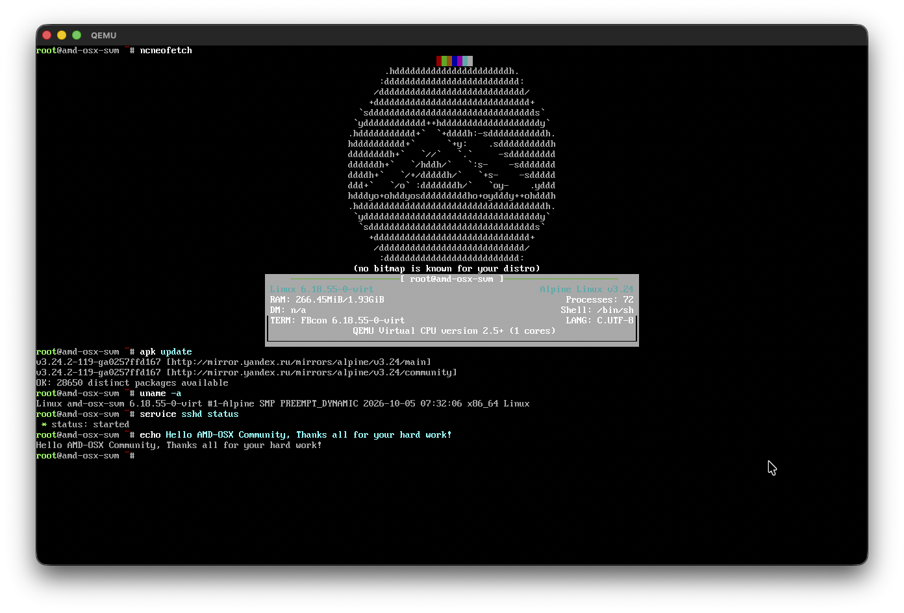

# osx-svm-accel — аппаратное ускорение AMD SVM для QEMU на macOS

[English](../../README.md)

AMDVM — экспериментальный AMD SVM provider для x86_64 macOS и нативный QEMU-акселератор `amdsvm`. Kernel extension исполняет гостевые инструкции через SVM; QEMU предоставляет виртуальную машину и модель устройств. Пользователь выбирает свои диски, установочные образы, RAM и топологию CPU обычными параметрами QEMU. Проверки названия гостевой ОС и встроенного образа нет.

На референсном Ryzen 7 5700X Hackintosh с macOS Tahoe 26.0.1 Alpine Linux 3.24 загружается с ISO и установленного диска до рабочей консоли без дополнительных параметров гостевого ядра. Два гостевых ядра online прошли короткую нагрузку с закреплением процессов при 256 МиБ RAM. Alpine также загружалась с 4 ГиБ: в том более раннем прогоне online оставался только CPU0. Отдельная конечная ROM прошла с двумя исполняемыми vCPU и 4 ГиБ. Это разные результаты.

AMDVM не требует дополнительных патчей или собственной сборки XNU поверх используемой конфигурации Hackintosh. Для исполнения гостевого CPU не используются Hypervisor.framework и TCG; перехваченные операции эмулирует QEMU.

**Исследовательский прототип, проверенный на одном хосте.** Прочтите [риски](risks.md). Проверка одной гостевой ОС не доказывает совместимость с другими.



Скриншот относится к более раннему запуску 1 vCPU / 2 ГиБ. Результаты SMP — в [референсных evidence](../../evidence/reference-2026-10-14/README.md).

## Сборка и использование

```sh
make provider-experimental  # только сборка, без установки и аппаратного входа
make checks                # офлайн-проверки provider
make qemu                  # закреплённый upstream + наложение исходников + сборка
make qemu-checks            # офлайн-тесты QEMU
```

Нужны x86_64 macOS, Xcode Command Line Tools, Python 3, Git, Ninja, pkg-config, GLib и Pixman. SLIRP берётся из системы либо закреплённого subproject QEMU. [Гайд](build-and-run.md) описывает подпись, ручную установку, проверку, откат и команды запуска гостей.

После загрузки соответствующего provider выбирается:

```text
-accel amdsvm,confirm-experimental-run=on,confirm-no-kdp-watchpoints=on
```

Далее используются обычные `-m`, `-smp`, `-drive`, `-cdrom`. Публикационный frontend принимает **1–2 vCPU и 256 МиБ–4 ГиБ RAM** с учётом возможностей provider и успешной подготовки памяти. CPU hotplug отклоняется. Допустимые пределы не означают проверки всех сочетаний и гостевых ОС. Общий frontend прошёл сборку, офлайн и live prelaunch ABI проверки; аппаратные прогоны относятся к предшествующему frontend QEMU. [Манифест](../../MANIFEST.json) различает их.

Целостность распакованного пакета: `shasum -a 256 -c SHA256SUMS`.

## Состав

| Путь | Содержимое |
| --- | --- |
| `svm-kext/` | provider, версионированный ABI, диагностический клиент, mock headers |
| `tools/` | офлайн-тесты и скрипты подготовки/сборки QEMU |
| `qemu/` | 40 добавленных/изменённых upstream-файлов и manifest; полного дерева нет |
| `evidence/` | выбранные результаты, идентичность артефактов и границы проверки |
| `docs/en/`, `docs/ru/` | английская и русская документация |

## Документация

- [Архитектура](architecture.md)
- [Изменения QEMU](qemu-integration.md)
- [Железо и матрица проверок](hardware.md)
- [Сборка, запуск и откат](build-and-run.md)
- [Риски и ограничения](risks.md)
- [Метод разработки](development.md)
- [История проекта](story.md)
- [Исследовательское предложение AMD-HVF](amd-hvf-proposal.md)

[osx-svm-poc](https://github.com/nekkitl/osx-svm-poc) остаётся отдельным минимальным PoC HLT-перехода. Здесь публикуются интеграция с QEMU и текущий provider. Следующие задачи: повторяемые SMP lifecycle-тесты, дополнительные размеры ресурсов, совместимость гостей и измерения производительности. AMD-HVF — отдельное будущее исследование совместимости.

## Лицензия

Собственный код проекта: GPL-2.0-or-later. Файлы на основе upstream QEMU сохраняют свои уведомления и применимые лицензии. См. [LICENSE](../../LICENSE), [qemu/COPYING](../../qemu/COPYING), [THIRD_PARTY.md](../../THIRD_PARTY.md).

© 2026 Nick Ognev.

## Участие в разработке

Правила изменений, проверок и аппаратных отчётов: [CONTRIBUTING.md](../../CONTRIBUTING.md). Issues и pull requests можно писать по-русски. Шаблоны issues включают аппаратные результаты, ошибки сборки/загрузки и предложения.
