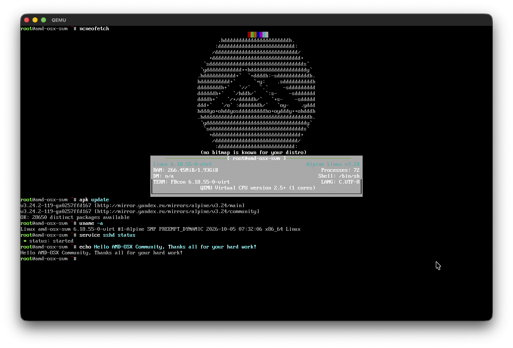

# От одной инструкции до работающего Linux: как я написал собственный VMM для AMD Hackintosh с помощью ИИ-агентов

*История о многолетней проблеме AMD-OSX, аппаратной виртуализации под XNU, одном kernel panic, работе автономных ИИ-агентов и следующей цели — AMD-HVF Compatibility Layer.*

Недавно я получил скриншот, который на первый взгляд совершенно ничем не примечателен. Обычное окно QEMU на macOS, внутри которого запущена Alpine Linux 3.24. Открыта консоль, выполнены несколько команд, отображается информация о процессоре и ядре системы. Ничего необычного, если не знать одну деталь: Linux исполняется с аппаратным ускорением AMD SVM на Hackintosh с процессором Ryzen, а виртуализацию обеспечивает мой собственный kernel extension для XNU и написанный под него accelerator QEMU.

Здесь нет Linux KVM, потому что хостовой системой является macOS. Нет Apple Hypervisor.framework, потому что его x86-реализация ориентирована на Intel VMX. Нет и программной эмуляции процессора через QEMU TCG. Вместо этого гостевой код действительно выполняется аппаратно через AMD SVM, а собственный VMM управляет состоянием виртуального процессора, памятью, перехватами и переключением между гостем и хостом.

Самое забавное, что первоначально я вообще не планировал писать полноценный гипервизор. Мне просто хотелось разобраться с одним из старейших ограничений AMD Hackintosh. А дальше всё постепенно превратилось в полноценное исследование процессорной архитектуры, XNU, многопроцессорной синхронизации и возможностей современной разработки с помощью автономных ИИ-агентов.

За этим результатом стоят не только успешные сборки и красивые скриншоты, но и неправильно настроенные биты VMCB, ошибки в отображениях физической памяти, многочисленные VMEXIT, проблемы с XSAVE, поломанные регрессионные тесты и один настоящий kernel panic. Причём значительную часть исследований и реализации выполняли ИИ-агенты, а мне приходилось управлять их работой, принимать архитектурные решения и постоянно проверять, что очередное заявление об успехе действительно подтверждается техническими фактами.

Но обо всём по порядку.

## AMD-OSX: когда система работает, но не совсем

Как многие знают, я люблю Hackintosh. Причём Hackintosh никогда не был занятием для слабых духом, а запуск macOS на AMD — уже отдельный инженерный вызов. Сообщество AMD-OSX годами занимается тем, что заставляет операционную систему Apple работать на процессорах, для которых она никогда официально не выпускалась. Патчи ядра, OpenCore, особенности микроархитектур AMD, совместимость системных компонентов и постоянные изменения новых версий macOS — всё это хорошо знакомо людям, которые хоть раз пытались добиться действительно стабильной работы такой системы.

В результате можно получить вполне полноценное рабочее окружение. У меня, например, работает macOS Tahoe на Ryzen с аппаратным ускорением графики, привычным набором программ и всей необходимой инфраструктурой. Система используется не только ради экспериментов, но и для повседневных задач. Однако даже если добиться практически идеальной работы Hackintosh, остаются ограничения, которые нельзя устранить очередным патчем совместимости процессора.

Одно из самых неприятных — аппаратная виртуализация.

На Intel Mac штатный Hypervisor.framework использует возможности Intel VMX. Процессоры AMD предоставляют собственную технологию аппаратной виртуализации — Secure Virtual Machine, или SVM. Это не два названия одного механизма, а разные архитектурные интерфейсы, имеющие собственные инструкции, управляющие структуры, правила обработки исключений и способы управления гостевым кодом.

В Intel VMX используются VMCS и инструкции семейства VMX. В AMD SVM основой является VMCB, а вход в гостевой режим выполняется инструкцией `VMRUN`. Различаются и механизмы управления прерываниями, перехватами, виртуальной памятью и состоянием процессора. Поэтому патчи, позволяющие XNU исполняться на Ryzen, автоматически не превращают Hypervisor.framework в совместимый с AMD гипервизор.

Отсюда и многолетняя проблема AMD-OSX: можно заставить macOS работать на процессоре AMD, но нельзя автоматически получить всю функциональность, доступную на официально поддерживаемой платформе.

Конечно, обходные пути существуют. QEMU умеет использовать TCG — программную эмуляцию, которая позволяет запускать гостевые системы без аппаратного гипервизора. Есть и старые реализации виртуализации, например VirtualBox 6.1.50 с собственным механизмом AMD SVM. VirtualBox 6.1.50 выполнял AMD SVM на этой машине с Tahoe без дополнительных патчей XNU для AMDVM. Это был практический прецедент работы независимого provider, а его исходники — архитектурный ориентир. Совместимость VirtualBox со всеми современными гостями здесь не оценивалась.

Если же тебе нужны виртуальные машины для лабораторий, исследований операционных систем, тестирования инфраструктуры или задач информационной безопасности, отсутствие нормального аппаратного ускорения становится весьма ощутимым ограничением. Особенно когда у тебя под рукой современный Ryzen, аппаратно поддерживающий виртуализацию, но операционная система не предоставляет подходящего интерфейса.

В какой-то момент я задумался: а насколько сложно реализовать собственный AMD SVM backend для macOS? Не пытаться переделать Hypervisor.framework и не переносить целиком KVM, а создать независимый механизм, который сможет использовать аппаратные возможности процессора непосредственно из XNU.

Ответ оказался довольно простым: сложно. Очень сложно. Но возможно.

## Первый эксперимент: VMRUN из XNU

Изначальная концепция была достаточно компактной. Создать собственный kernel extension, подготовить структуры AMD SVM и выполнить минимальную гостевую программу. Без настоящей виртуальной машины, BIOS, операционной системы и эмуляции устройств. Главной задачей было проверить, разрешает ли работающая macOS выполнить аппаратный переход в гостевой режим и корректно вернуться обратно.

AMD SVM использует структуру Virtual Machine Control Block, или VMCB, которая содержит управляющие параметры и часть архитектурного состояния гостя. Для входа в виртуализацию необходимо настроить соответствующие регистры процессора, подготовить host save area, включить `EFER.SVME` и выполнить инструкцию `VMRUN`. При возникновении перехватываемого события процессор возвращает управление гипервизору, а причина выхода записывается в управляющую структуру.

Первой гостевой программой стала всего одна инструкция — `HLT`. Если всё настроено правильно, процессор должен войти в гостевой режим, встретить HLT, сформировать `VMEXIT_HLT = 0x78` и вернуть управление kernel extension. После этого нужно восстановить исходное состояние процессора и убедиться, что эксперимент не оставил изменений, способных повлиять на работу хоста.

Звучит относительно просто, но даже на этом этапе пришлось разбираться с особенностями ABI XNU, IOKit, размерами структур, сохранением регистров и процессорным состоянием. Взаимодействие kernel и userspace требует аккуратности: несовпадение типов или размеров данных способно превратить совершенно безобидный вызов в повреждение памяти ядра.

В итоге первый аппаратный переход заработал. Процессор действительно выполнил гостевой HLT, вернул ожидаемый VMEXIT, а расширение смогло корректно завершить эксперимент и восстановить проверяемое SVM-состояние.

На базе этой работы я подготовил отдельный открытый проект — [osx-svm-poc](https://github.com/nekkitl/osx-svm-poc). Это небольшой исследовательский Proof of Concept, включающий XNU kernel extension, IOKit provider и userspace-клиент. Он демонстрирует принципиальную возможность использования AMD SVM под macOS, но не является полноценным гипервизором и не предназначен для запуска произвольных операционных систем.

Документация проекта доступна [на русском языке](https://github.com/nekkitl/osx-svm-poc/tree/main/docs/ru).

И здесь необходимо разделить два результата. Публичный osx-svm-poc подтверждает саму возможность аппаратного SVM-перехода. А дальнейшая разработка, которую я условно называю AMDVM, пошла значительно дальше и постепенно превратилась в полноценный прототип Virtual Machine Monitor.

## Почему я решил использовать ИИ-агентов

Примерно на этом этапе мне стало интересно проверить ещё одну гипотезу. Можно ли организовать разработку настолько сложного низкоуровневого ПО с помощью автономных ИИ-агентов, если не воспринимать их как обычное автодополнение редактора или генератор кода по текстовому запросу?

Сегодня вокруг ИИ-разработки существует довольно странная поляризация. Одни уверены, что достаточно правильно сформулировать задачу — и нейросеть самостоятельно напишет любую систему. Другие считают такой подход бесполезным, потому что сгенерированный код часто содержит ошибки, лишние зависимости или решения, которые невозможно нормально поддерживать. На мой взгляд, обе позиции упускают важную часть происходящего.

ИИ-агенты действительно способны выполнять значительный объём инженерной работы. Они могут изучать большие кодовые базы, анализировать архитектурную документацию, исследовать чужие реализации, писать отдельные компоненты, проводить ревью, запускать тесты и исправлять ошибки. Но всё это не означает, что агенты автоматически понимают цели проекта, его модель безопасности и последствия принимаемых решений.

Поэтому я не ставил им абстрактную задачу «напишите гипервизор». Работа была организована вокруг отдельных подсистем, технических ограничений и проверяемых результатов. Агенты исследовали исходники XNU, изучали архитектуру AMD SVM, разбирали механизмы VirtualBox и QEMU, готовили изменения в коде, писали тесты и анализировали результаты аппаратных запусков. При этом архитектурное направление, требования к безопасности и критерии завершения экспериментов оставались под моим контролем.

И здесь есть принципиально важный момент. Для управления подобной разработкой человеку необходимо обладать серьёзными техническими знаниями. Недостаточно уметь сформулировать промпт и оценить, насколько убедительно выглядит ответ модели. Нужно понимать архитектуру x86, особенности гипервизоров, устройство операционных систем, управление физической памятью, синхронизацию процессоров, обработку прерываний и последствия ошибок на уровне ядра.

Например, агент может успешно собрать kernel extension, выполнить несколько аппаратных тестов и сообщить, что механизм безопасен. Но успешная компиляция не подтверждает корректность world-switch. Несколько успешных VMRUN не гарантируют сохранность всех регистров хоста. А правильное восстановление `EFER.SVME` ещё не означает, что во время гостевого исполнения XNU сможет своевременно обслуживать межпроцессорные прерывания.

Важнейшей частью работы стало именно определение границ доказательств. Что подтверждает конкретный тест? Какие свойства он не проверяет? Какие инварианты могут быть нарушены? Какие дополнительные измерения необходимы, прежде чем переходить к следующему этапу?

На практике агенты далеко не всегда действовали идеально. Иногда они зацикливались на повторных аудитах, усложняли архитектуру без необходимости, ломали ранее работавшие smoke-тесты или слишком оптимистично интерпретировали результаты. Приходилось останавливать эксперименты, возвращаться к исходным требованиям и заставлять систему исследовать конкретную причину отказа, а не добавлять очередной обходной механизм.

Но именно при таком подходе агентная разработка начала демонстрировать свои реальные возможности. Вместо последовательного ручного исследования каждой отдельной подсистемы появилась возможность организовать параллельную работу над кодом, документацией, тестами и архитектурными гипотезами.

**ИИ-агенты способны масштабировать инженерную компетенцию, но не создают её из ничего. Чем выше автономность агентов, тем важнее знания и ответственность человека, который ими управляет.**

AMDVM стал весьма наглядной проверкой этого утверждения.

## От аппаратного примитива к собственному QEMU accelerator

После первого успешного VMRUN следующей целью стала интеграция с QEMU. Я не хотел самостоятельно реализовывать всю модель PC, включая накопители, PCI, видеокарты, BIOS и остальные устройства. Гораздо логичнее использовать существующий QEMU, который уже умеет предоставлять гостю полноценную виртуальную платформу, и добавить в него собственный механизм аппаратного исполнения процессора.

Так появилась архитектура с отдельным accelerator `amdsvm`.

QEMU управляет виртуальной машиной, моделирует устройства и обрабатывает необходимые архитектурные события. AMDVM, в свою очередь, отвечает за аппаратное исполнение гостевого CPU, отображение памяти и безопасный переход между пользовательским процессом, kernel provider и AMD SVM.

Схематично это выглядит следующим образом:

```text
macOS Tahoe / XNU
        |
        v
QEMU -accel amdsvm
        |
        v
IOUserClient
        |
        v
AMDVMProbe.kext
        |
        v
AMD SVM / VMRUN
        |
        v
Guest x86-64
```

Чтобы такая система заработала, одного обработчика VMRUN уже недостаточно. Потребовалось реализовать передачу архитектурного состояния x86, работу с регистрами общего назначения, сегментами, CR, DR и MSR, поддержку XSAVE/XRSTOR, управление vCPU, обработку исключений и различных классов VMEXIT.

Отдельным направлением стала виртуальная память. QEMU создаёт оперативную память гостя внутри своего пользовательского процесса, но аппаратному SVM для работы Nested Page Tables необходимы соответствующие физические страницы. Пришлось реализовать механизм закрепления пользовательской памяти через IOMemoryDescriptor, получение физических адресов, построение NPT и корректную синхронизацию отображений с моделью памяти QEMU.

Причём очень быстро выяснилось, что просто сопоставить гостевые адреса с физической памятью недостаточно. Нужно учитывать PAT и MTRR, разные типы памяти, права доступа, изменения отображений и необходимость корректного TLB flush. Если ошибиться, гость может получить неправильные данные, обратиться к запрещённой памяти или попасть в ситуацию, когда аппаратная трансляция перестанет соответствовать модели виртуальной машины.

Не менее интересной оказалась проблема управления ресурсами. Что произойдёт, если операция освобождения закреплённой памяти завершится ошибкой? Как предотвратить повторное освобождение объекта, который уже принадлежит другому контексту? Как гарантировать, что неудачное уничтожение виртуальной машины не оставит в ядре опасные ссылки на физические страницы?

В результате появились собственные механизмы quarantine, проверки ownership, generation counters, rollback и fault injection. На фоне запуска настоящего Linux это выглядит довольно скучно, но именно подобные детали отличают демонстрацию процессорной инструкции от системы, которую вообще можно пытаться использовать для исполнения произвольного гостевого кода.

Постепенно AMDVM начал приобретать черты настоящего гипервизора.

## Одна буква, за которой стояла почти вся архитектура

Первой целью после интеграции в QEMU был небольшой microguest. ROM-программа должна была выполнить CPUID, отправить символ в порт отладки и остановиться через HLT. Ожидалась последовательность аппаратных выходов: CPUID, I/O и HLT.

Вместо этого процессор возвращал `VMEXIT_EXCP_UD = 0x46`, то есть исключение недопустимой инструкции.

Началось исследование. Агенты проверяли reset vector, расположение ROM, состояние сегментных регистров, CR0, EFER, NPT и фактические байты гостевого кода. На первый взгляд всё выглядело корректно. Но в итоге обнаружилась достаточно неприятная ошибка: обработчик RUN очищал неправильное поле VMCB и непосредственно перед аппаратным входом фактически выключал `NP_ENABLE`.

После исправления процессор наконец выполнил ожидаемую последовательность, а QEMU обработал все три выхода.

Затем эксперимент усложнили. Была подготовлена настоящая QEMU-машина q35 с 512 МиБ оперативной памяти. Гостевая программа выполняла чтение байта из RAM по адресу `0x1000`, после чего отправляла его через эмулируемый порт отладки. В памяти находилось значение `0x41`, соответствующее символу `A`.

И QEMU действительно вывел `A`.

Казалось бы, ничего особенного. Одна буква в терминале. Но за ней стоял уже совершенно другой объём работающей инфраструктуры: память QEMU, закреплённые физические страницы, NPT, аппаратный VMRUN, обращение гостевого процессора к памяти, VMEXIT по I/O, обработка устройства и возврат управления XNU.

В этот момент стало очевидно, что AMDVM перестал быть просто экспериментом с отдельными инструкциями. У нас появилась работающая основа аппаратного ускорения виртуальной машины.

Но следующая проблема оказалась куда серьёзнее.

## Первый kernel panic

Одной из важнейших возможностей полноценного гипервизора является принудительная остановка виртуального процессора. Гостевая система не обязана добровольно выполнять HLT или другую перехватываемую инструкцию в удобный для хоста момент. Поэтому гипервизор должен уметь возвращать управление операционной системе независимо от поведения гостя.

Именно во время исследования этого механизма macOS впервые ушла в настоящий kernel panic.

В диагностике XNU появились сообщения:

```text
NMIPI for unresponsive processor
TLB flush timeout
IPI timeout
unresponsive CPU bitmap: 0x1
```

Один логический процессор ожидал от другого подтверждения операции очистки TLB, но не получил его вовремя. CPU, от которого ожидался ответ, в этот момент был связан с исполнением AMDVM. В результате XNU признал процессор неотвечающим и инициировал панику.

Это уже не ошибка виртуальной машины, не исключение гостя и не падение QEMU. Это нарушение взаимодействия экспериментального VMM с многопроцессорной моделью самой macOS.

После перезагрузки пришлось разбирать panic log, символизировать адреса внутри assembly wrapper и исследовать последовательность аппаратного world-switch практически по инструкциям. Особое внимание уделили `CLGI`, `STI`, `VMRUN`, `CLI`, `STGI`, host IF/GIF и механизму физического перехвата прерываний.

Один из наиболее интересных результатов символизации показал, что диагностический RIP находился непосредственно после `STGI`. При этом обычный флаг IF ещё оставался сброшенным. Но делать вывод, что процессор завис именно на этой инструкции, было бы неправильно: диагностический NMI мог ожидать восстановления GIF и попасть в обработчик только после завершения соответствующего критического участка.

Параллельно мы начали изучать существующие реализации AMD SVM, в том числе исходники старого VirtualBox 6.1.50. Его world-switch использовал похожую схему входа в гостевой режим и восстановления состояния хоста. Это был полезный архитектурный ориентир, особенно с учётом того, что сам VirtualBox исторически имел собственную реализацию AMD SVM.

Работа VirtualBox на этом хосте показывала, что дополнительный форк XNU не является обязательным требованием. Она не доказывала безопасность AMDVM: критические свойства нашего world-switch приходилось проверять отдельно.

После первого kernel panic подход к экспериментам заметно изменился. Теперь было недостаточно показать, что процессор способен выполнять гостевой код и корректно возвращаться по обычному VMEXIT. Требовалось убедиться, что во время аппаратного исполнения гостя XNU сохраняет возможность обслуживать критические межпроцессорные операции.

Это оказалось одной из самых сложных и интересных частей проекта.

## Когда гипервизор начинает мешать операционной системе

Для исследования взаимодействия AMDVM с XNU появились отдельные диагностические инструменты, DTrace-точки и контролируемые сценарии аппаратного исполнения. Мы начали измерять задержки TLB shootdown, фиксировать физические VMEXIT и проверять участие CPU в межпроцессорных операциях.

В одном из аппаратных прогонов было зафиксировано 270 входов VMRUN и 1 078 удалённых запросов TLB flush, направленных на CPU гостя. Все наблюдавшиеся запросы завершились, а максимальная измеренная задержка составила 166 микросекунд. После теста проверяемое SVM-состояние всех 16 логических процессоров совпало с исходным.

Это был очень хороший результат, особенно после предыдущего timeout. Но он ещё не доказывал, что произвольный гостевой код не сможет нарушить работу хоста. Нам нужно было отдельно проверить, способен ли XNU инициировать операцию `mp_rendezvous()` непосредственно во время активного VMRUN.

Сначала такой эксперимент упорно не получался. Диагностический query выполнялся уже после завершения SeaBIOS, поэтому вызов `mp_rendezvous()` не попадал в аппаратное окно исполнения гостя. Появились подозрения на сериализацию IOKit, блокировки provider и неправильную организацию control plane.

Позднее выяснилась куда более простая причина: SeaBIOS завершалась приблизительно за 8 миллисекунд, а отдельный диагностический процесс добирался до kernel provider примерно за 24 миллисекунды. Запрос просто не успевал попасть в нужное временное окно.

Это был хороший урок в области технической диагностики. Отсутствие наблюдаемого события не доказывает отсутствия механизма, а неправильно поставленный эксперимент вполне способен увести исследование в совершенно ненужную сторону.

Для следующей проверки мы использовали конечную ROM-программу с контролируемым циклом и HLT в конце. Она позволяла удерживать гостя в исполнении достаточно долго, чтобы другой процесс успел инициировать rendezvous, но при этом не требовала запуска настоящей операционной системы.

И на этот раз эксперимент прошёл.

Запрос rendezvous действительно пришёлся на аппаратное исполнение гостя, процессор вернулся через `VMEXIT_INTR`, были получены согласованные результаты по всем 16 CPU, а остальные 15 логических процессоров продолжали планироваться. Дополнительно QMP смог остановить гостя за измеренные 0,865 миллисекунды.

Важно правильно интерпретировать такие результаты. Мы не получили математического доказательства, что AMDVM способен остановить любую гостевую нагрузку за 0,865 мс. Не доказали и полную безопасность всех возможных сочетаний аппаратных событий. Но получили прямое подтверждение работы критического механизма: XNU действительно может инициировать межпроцессорную операцию во время исполнения гостя, а AMDVM способен вернуть управление через физический VMEXIT в испытанном сценарии.

Именно здесь разработка окончательно перестала быть вопросом «как вызвать VMRUN». Нам пришлось исследовать, как гипервизор должен сосуществовать с полноценной многопроцессорной операционной системой, не лишая её контроля над собственными процессорами.

На мой взгляд, это был один из важнейших этапов всей работы.

## SeaBIOS: переход от синтетических тестов к настоящей виртуальной машине

Когда базовые механизмы стали достаточно зрелыми, мы решили перейти к исполнению настоящей SeaBIOS. И здесь выяснилось, что между микрогостем из нескольких инструкций и реальной прошивкой существует огромная разница.

SeaBIOS работает с полноценной моделью PC. Ей необходимы ROM, RAM, PCI, контроллеры прерываний, устройства, области MMIO, традиционные порты ввода-вывода и корректная карта памяти. Многие из этих компонентов QEMU уже умеет моделировать, но AMDVM должен правильно передавать ему соответствующие обращения и согласовывать аппаратные отображения с MemoryRegion.

Первоначальные запуски завершались на неподдержанных VMEXIT. Затем появился NPF — Nested Page Fault, который потребовал более точной обработки обращений к RAM, ROM и MMIO. Позднее возникли сложности с VGA, гостевыми исключениями и состоянием виртуального CPU.

Но постепенно SeaBIOS начала продвигаться дальше.

Сначала мы увидели, что прошивка действительно выполняет собственный код. Затем в окне QEMU появилась загрузка с DVD, после чего управление перешло к ISOLINUX. На экране отобразилось приглашение `boot:`.

Это был первый действительно наглядный результат. До этого большинство достижений выглядели как диагностические строки, адреса регистров и коды VMEXIT. Теперь же QEMU показывал совершенно обычный экран загрузчика, работающего поверх собственного AMD SVM backend.

Следующая цель была очевидной — добраться до кода ядра Alpine Linux.

После передачи управления загрузчиком гость действительно дошёл до исполнения ядра, но остановился на `VMEXIT_RDTSC = 0x6E`. Изначально это выглядело как очередной неподдержанный аппаратный перехват. Но анализ показал, что сам обработчик RDTSC даже не запускался: раньше возникала ошибка сохранения контекста, и provider возвращал `context_status=-10`.

Пришлось снова возвращаться к XSAVE, состоянию interruptibility и точной диагностике архитектурного контекста. Отдельно исследовались ошибки FPU preflight, сохранение XSTATE, обработка HLT и доставка гостевых исключений, включая `#PF`.

Иногда после очередного исправления QEMU продвигался дальше, но при этом ломались старые smoke-тесты. Иногда виртуальная машина доходила до нового этапа загрузки, но неправильно завершалась после QMP stop. В какой-то момент host FPU preflight зафиксировал диагностические flags `0xc0`, после чего QEMU перевёл машину в shutdown. Подобные ситуации приходилось разбирать отдельно, не отключая защитные проверки ради очередного успешного запуска.

Несмотря на это, прогресс постепенно становился всё более заметным. Linux начал выводить реальные сообщения ядра, инициализировать драйверы и выполнять ранний userspace.

Затем появился `Alpine Init`.

## Alpine Linux: от ядра до OpenRC

Первые сообщения Linux были настоящим прорывом. До этого мы видели работу BIOS и загрузчика, но теперь гостевая операционная система самостоятельно инициализировала процессорное окружение, память и драйверы. Очень быстро выяснилось, что и здесь придётся разбираться не только с архитектурой CPU, но и с полноценной моделью виртуальных устройств.

Alpine начала обнаруживать контроллеры, регистрировать драйверы, работать с виртуальным CD-ROM и пытаться смонтировать загрузочный носитель. В логах появились сообщения об ISO9660, SquashFS и обнаружении оптического накопителя.

Позднее система смогла успешно смонтировать загрузочный носитель, прочитать необходимые данные и подготовить rootfs. Началась инициализация OpenRC — системы запуска служб Alpine Linux.

В этот момент можно было уже уверенно говорить, что AMDVM исполняет не просто ядро Linux, а полноценный ранний userspace гостевой операционной системы. Работают обращения к памяти, драйверы, файловые системы, обработка прерываний и различные компоненты виртуальной платформы.

Но оставался ещё один неприятный дефект.

При включении графического драйвера `bochs-drm` QEMU обнаруживал пересекающиеся отображения видеопамяти. Проблема находилась в тракте взаимодействия виртуальной видеокарты, MemoryRegion и отображений гостевой памяти.

Это был тот случай, когда можно было попытаться получить быстрый результат, отключив проверки пересечений. Но подобное решение означало бы ослабление инвариантов памяти ради красивого скриншота. После всех предыдущих проблем с NPT и kernel panic такой подход выглядел совершенно неправильным.

Вместо этого мы решили разделить две независимые задачи: работоспособность гостевой операционной системы и корректность графической подсистемы.

Для диагностического запуска использовали штатный параметр Linux `nomodeset`, позволяющий избежать проблемного пути kernel modesetting. При этом сами проверки памяти оставались включенными.

И Alpine наконец загрузилась до приглашения входа.

После этого удалось войти под root и выполнить реальные команды внутри гостя. Linux отвечал на `uname -a`, предоставлял `/proc/cpuinfo`, показывал смонтированные файловые системы и позволял работать с обычной командной оболочкой.

В частности, в госте были доступны ISO9660 на `/media/cdrom` и SquashFS на `/.modloop`. Это подтверждало не только исполнение пользовательских процессов, но и реальную работу гостя с виртуальным накопителем и файловыми системами.

Первоначальная цель уже была достигнута: Alpine Linux работала через аппаратный AMD SVM backend под macOS.

Но я решил провести ещё один эксперимент.

## Запуск без специальных параметров ядра

После успешной загрузки с диагностическими параметрами мне стало интересно, сможет ли Alpine стартовать в обычной конфигурации. Без `nomodeset`, без специальных аргументов ранней serial-консоли и других настроек, которыми приходилось пользоваться во время исследования.

По сути, хотелось проверить, насколько близко AMDVM подошёл к поведению обычного аппаратного гипервизора. Чтобы пользователь мог выбрать загрузочный носитель, запустить виртуальную машину и получить рабочую операционную систему, не зная ничего о том, сколько проблем пришлось решить внутри provider.

Я запустил Alpine Linux без дополнительных параметров ядра.

SeaBIOS прошла POST, ISOLINUX передал управление ядру, Linux инициализировал оборудование, смонтировал файловые системы, запустил OpenRC и предоставил обычную VGA-консоль. После ввода имени пользователя я получил работающую оболочку root с приглашением:

```text
localhost:~#
```

Внутри гостя работала Alpine Linux 3.24 с ядром `6.18.52-0-virt`. Команды успешно выполнялись, процессор определялся как виртуальный CPU QEMU с `AuthenticAMD`, а система предоставляла ожидаемое пользовательское окружение.

И всё это выполнялось через собственный AMD SVM accelerator на macOS Tahoe.

Без Linux KVM. Без Hypervisor.framework. Без QEMU TCG. Без дополнительных параметров ядра гостя.

Именно здесь первоначальная исследовательская задача превратилась в работающий прототип VMM.

Важно не путать этот результат с готовностью гипервизора к промышленной эксплуатации. Полноценная стабильность требует длительных нагрузочных проверок, испытаний других гостевых систем, повторных циклов запуска и завершения VM, проверки SMP, обработки редких исключений, восстановления ресурсов и других сценариев. Успешная интерактивная Alpine не доказывает автоматически корректность любого гостевого кода.

Но принципиальная возможность уже подтверждена аппаратно.

**На AMD Hackintosh с macOS Tahoe работает полноценная гостевая Alpine Linux через собственный AMD SVM backend.**

И теперь возникает интересный вопрос: а что дальше?

## Два гостевых ядра online

Позднее Alpine загрузилась и с 4 ГиБ RAM, но второй настроенный vCPU оставался offline. Конечная SMP ROM уже исполнялась на обоих vCPU, поэтому простой успешный SIPI не доказывал завершение Linux AP startup.

Диагностика нашла конкретный дефект QEMU: флаг `provider_halted`, установленный после HLT SeaBIOS, сохранялся после нового INIT/SIPI. CPU1 уже получил Linux vector, `CS.base=0x99000`, `RIP=0`, но прежний флаг снова блокировал аппаратный вход.

После сброса этого флага при архитектурном startup Alpine с 256 МиБ RAM показала `online=0-1`, `nproc=2`, один socket и два core ID. Два конечных процесса, закреплённых за разными ядрами, посчитали правильный SHA-256. Stop, poweroff и сравнение SVM MSR всех 16 CPU хоста прошли. Это короткое функциональное подтверждение SMP, не завершённая проверка длительной стабильности.

## Следующее исследование

AMD-HVF — отдельное предложение совместимости, а не текущая возможность. См. [предложение](amd-hvf-proposal.md).

## Вместо заключения

Когда я начинал исследовать AMD SVM под macOS, первоначальная цель была довольно приземлённой. Мне хотелось понять, можно ли вообще использовать аппаратную виртуализацию на собственном AMD Hackintosh, не пытаясь заставить Hypervisor.framework работать с неподдерживаемой процессорной архитектурой.

Первый успешный VMRUN стал доказательством принципиальной возможности. Затем появилась интеграция с QEMU, настоящая гостевая память, NPT, обработка аппаратных выходов и механизм управления виртуальным процессором. Постепенно мы дошли до SeaBIOS, ISOLINUX и первых инструкций Linux, а затем — до Alpine Init, OpenRC и работающей командной оболочки.

По дороге пришлось столкнуться с проблемами, которые невозможно решить одним удачным промптом. Были ошибки VMCB, сложные сценарии управления памятью, проблемы XSAVE, гостевые исключения и конфликты MMIO. Был настоящий kernel panic, после которого пришлось исследовать межпроцессорные прерывания, TLB shootdown и взаимодействие собственного VMM с многопроцессорной моделью XNU.

И были ИИ-агенты, которые выполняли огромный объём технической работы, но постоянно нуждались в грамотном инженерном управлении.

В итоге я получил работающий прототип VMM, способный аппаратно исполнять полноценную Alpine Linux под macOS Tahoe на Ryzen. Гостевая система загружается без специальных параметров ядра, предоставляет обычную интерактивную консоль и выполняет пользовательские команды.



Это ещё не законченный гипервизор промышленного уровня, и впереди остаётся немало работы по устойчивости, производительности и совместимости. Но главная задача уже решена: аппаратная виртуализация AMD SVM под работающим XNU не просто возможна — она реализована и проверена на настоящей гостевой операционной системе.

Теперь у проекта появляется следующая цель — **AMD-HVF Compatibility Layer**. Если AMDVM уже способен выполнять гостевой код аппаратно, логично исследовать возможность предоставить этот механизм через совместимый интерфейс x86 Hypervisor.framework. Не переписывая штатный гипервизор Apple и не пытаясь превратить AMD в Intel, а построив самостоятельный слой трансляции между программным контрактом VMX и реальными возможностями AMD SVM.

Получится ли добиться широкой совместимости со сторонним ПО, пока неизвестно. Но теперь это уже не рассуждение на тему «было бы неплохо», а конкретная инженерная гипотеза, для проверки которой существует работающая аппаратная основа.

И, пожалуй, самое забавное во всей этой истории заключается в том, насколько далеко всё зашло от первоначального желания просто нормально запускать виртуальные машины.

**Я хотел аппаратную виртуализацию на своём AMD Hackintosh. В итоге пришлось написать собственный VMM. А теперь хочется сделать его совместимым с интерфейсом Apple.**

Продолжение следует.
